# 🎓 PLACEearly — Multi-Tenant Campus Placement Operating System

[](https://github.com/sandeep-kumar-270904/campus_placement/actions)
[](client/public/manifest.webmanifest)
[](server/tests/pwaAndAccessibility.test.js)
[](server/tests)
[](package.json)

**PLACEearly** is an institutional-grade, multi-tenant placement management platform engineered to automate campus hiring operations for colleges, universities, corporate recruiters, and students.

Featuring **cryptographic Ed25519 academic seals**, a **configurable placement policy engine** (One-Offer, Dream Caps, Tier thresholds), a **server-isolated Anthropic Claude AI suite**, an **installable Progressive Web App (PWA)**, and **automated NAAC/NIRF reporting**.

---

## 🏛️ System Architecture

```mermaid
flowchart TD
    subgraph ClientTier["Client Tier (Installable PWA & Responsive Web)"]
        UI_PWA["Progressive Web App Shell (Vite + React)"]
        UI_STUDENT["Student Workspace\n(Opportunities, Mock Interview, Resume Match)"]
        UI_TPO["TPO Administrative Desk\n(Drives, Verification Queue, Policy Engine, Reports)"]
        UI_RECRUITER["Recruiter Portal\n(Company Drives, Shortlist Roster, Slot Allocator)"]
        UI_THEME["Theme (Dark/Light) & i18n\n(English, Telugu, Hindi)"]
    end

    subgraph ApiGateway["API Gateway & Security Layer"]
        CORS["Strict CORS Allowlist"]
        HELMET["Helmet HTTP Security Headers"]
        RATE["Sliding-Window Rate Limiter"]
        REQ_ID["X-Request-Id Correlation & Structured JSON Logger"]
        SENTRY["Sentry Error Monitoring"]
        HEALTH["/healthz & Readiness Probes"]
    end

    subgraph AuthAndTenancy["Multi-Tenant Isolation & RBAC Engine"]
        JWT_AUTH["Bcrypt (Cost 12) + Rotating Refresh Tokens"]
        TENANT_GUARD["AsyncLocalStorage Tenant Context\n(Strict College Scoping & Spoof Rejection)"]
        RBAC_MATRIX["RBAC Matrix (Student, TPO, Recruiter, Coordinator, Principal)"]
        ZOD_VALID["Zod Schema Payload Validation"]
    end

    subgraph CoreServices["Domain Engines & Core Micro-Services"]
        SEAL_ENG["Ed25519 Cryptographic Verification Seal Engine\n(Tamper Invalidation Pre-Save Hooks)"]
        POLICY_ENG["Configurable Placement Policy Engine\n(Dream Cap, Tiers, Blackouts, Overrides, Fairness)"]
        AI_SERVICE["Anthropic Claude 3.5 Sonnet Service\n(Prompt-Injection Neutralization & XML Boundaries)"]
        REPORT_ENG["NAAC / NIRF Automated Report Exporter\n(XLSX, PDF, CSV Streaming)"]
        NOTIF_BUS["Domain EventBus & Multi-Channel Notification Queue"]
    end

    subgraph DataStorage["Data & Storage Infrastructure"]
        MONGO_DB[("MongoDB Database\n(Compound Tenant Indexes)")]
        DOC_STORAGE["Storage Provider\n(Local Disk / AWS S3 / Cloudflare R2)"]
        BACKUP_CRON["Automated Daily Compressed Backups\n(Retention Pruning & Disaster Recovery)"]
    end

    ClientTier --> ApiGateway
    ApiGateway --> AuthAndTenancy
    AuthAndTenancy --> CoreServices
    CoreServices --> DataStorage
```



---

## 👥 Roles & Permissions Matrix

PLACEearly strictly enforces institutional role boundaries. Users are restricted to their assigned college tenant, and corporate recruiters are restricted exclusively to their company's drives.

| Role | Tenant Scoping | Drives Access | Verification Authority | Policy Override | Recruiter Portal | Analytics & Reports |
| :--- | :--- | :--- | :--- | :--- | :--- | :--- |
| **Student** | Own College Only | View Eligible & Apply | Read-only verified seal | Request exception | ❌ Denied (403) | Personal dashboard |
| **Department Coordinator** | Own College + Branch | View Department Drives | Verify department students | ❌ Denied (403) | ❌ Denied (403) | Branch reports |
| **Training & Placement Officer (TPO)** | Own College Full | Full CRUD & Publish | Full Ed25519 Seal Authority | Full Override Grant | Supervise all drives | Full NAAC/NIRF & Brochures |
| **Principal / Dean** | Own College Full | Read-only view | View records | View overrides report | ❌ Denied (403) | College-wide Analytics |
| **Recruiter** | Assigned Company Only | Company's Drives Only | View verified seal | ❌ Denied (403) | Shortlist, Hold, Offer | Drive funnel analytics |
| **SuperAdmin** | Global Platform | All Colleges | Audit only | Global settings | Platform oversight | Cross-institution health |

---

## 🚀 Quick Start & Local Setup

### Prerequisites
- **Node.js**: v20+ (v22 recommended)
- **MongoDB**: v6+ (or MongoDB Atlas cluster)
- **npm**: v10+

### 1. Clone & Install Dependencies
```bash
git clone https://github.com/sandeep-kumar-270904/campus_placement.git
cd campus_placement

# Install root dependencies
npm install

# Install client and server packages
npm --prefix client install
npm --prefix server install
```

### 2. Configure Environment Variables
Copy the provided environment template:
```bash
cp .env.example .env
cp server/.env.example server/.env
```
*(Review `.env.example` below for all configurable variables)*

### 3. Seed Production Demo Data
Populate 2 colleges, 500 verified students with Ed25519 seals, 20 placement drives, recruiter accounts, and alumni mentors:
```bash
npm run seed:production
```

### 4. Launch Development Servers
Launch both backend API (`http://localhost:5001`) and frontend client (`http://localhost:5173`) with live reload:
```bash
npm run dev
```

### 5. Run Test Suites
```bash
# Run all 375+ backend unit, policy, and integration tests
npm test

# Run tests with code coverage report
npm run test:coverage

# Run Playwright End-to-End smoke suite
npm run test:e2e
```

---

## 🔐 Environment Variables Reference

| Variable | Type | Default | Description & Production Guidance |
| :--- | :--- | :--- | :--- |
| `PORT` | Number | `5001` | Express server HTTP listening port. |
| `NODE_ENV` | String | `development` | Set to `production` in live deployments for strict security validation. |
| `CLIENT_URL` | String (URL) | `http://localhost:5173` | Allowed frontend URL for CORS, cookies, and deep links. |
| `MONGO_URI` | String (URI) | `mongodb://127.0.0.1:27017/placeearly` | MongoDB connection string (Atlas replica set recommended). |
| `SLOW_QUERY_THRESHOLD_MS` | Number | `100` | Slow database query duration threshold for structured JSON logging. |
| `JWT_SECRET` | String | *Required in Prod* | Secret key for signing 15-minute access tokens (min 32 chars). |
| `JWT_REFRESH_SECRET` | String | *Required in Prod* | Secret key for signing 7-day rotating refresh tokens. |
| `ED25519_PRIVATE_KEY` | String | *Optional in Dev* | Base64/Hex private key for cryptographic Ed25519 verification seals. |
| `ED25519_PUBLIC_KEY` | String | *Optional in Dev* | Base64/Hex public key matching signing keypair. |
| `ANTHROPIC_API_KEY` | String | *Optional* | Anthropic Claude API key for AI Resume Matcher and Mock Interviewer. |
| `SENTRY_DSN` | String (URL) | *Optional* | Sentry APM and error monitoring connection string. |
| `STORAGE_PROVIDER` | String | `local` | Document storage provider: `local` (disk/tmpdir) or `s3` (AWS S3/R2). |
| `BACKUP_DIR` | String | `./backups` | Target directory for compressed daily database backup snapshots. |
| `BACKUP_RETENTION_DAYS` | Number | `14` | Number of days to retain database backup archives before pruning. |

---

## 💾 Database Backups & Disaster Recovery

PLACEearly includes an automated database backup and restore system with compressed archives, checksums, and retention cleanup.

### Create a Database Backup
```bash
npm run db:backup
```
- Creates a timestamped archive under `./backups/backup-YYYY-MM-DD/`.
- Compresses every MongoDB collection into individual `.json.gz` archives.
- Writes a verified `metadata.json` document with document counts and timestamps.
- Automatically purges backups older than `BACKUP_RETENTION_DAYS`.

### Restore from Backup
```bash
# Restore from the most recent backup
npm run db:restore

# Restore from a specific backup folder
npm run db:restore ./backups/backup-2026-11-01T00-00-00-000Z
```
- Verifies archive integrity against `metadata.json`.
- Restores collections with count validation and atomic error logging.
- Fully tested and verified via [`backupAndRestore.test.js`](server/tests/backupAndRestore.test.js).

---

## 🛡️ Security Architecture & Hardening

1. **Cryptographic Ed25519 Verified Academic Seals**:
   - Academic records (CGPA, active backlogs, graduation year) are canonically sorted and hashed using SHA-256.
   - The institution signs the hash with its Ed25519 private key, producing an authentic seal embedded into the student profile.
   - **Automatic Tamper Invalidation**: A Mongoose pre-save hook immediately invalidates the verification status (`isVerifiedByTPO: false`) if any user or database mutation modifies CGPA, backlogs, or roll number.

2. **Session Security & Refresh Token Rotation**:
   - Passwords hashed using Bcrypt with Work Cost **12**.
   - Short-lived 15-minute access tokens paired with 7-day rotating refresh tokens.
   - Token families track token lineage; if a revoked refresh token is replayed, the entire session family is instantly revoked.

3. **Multi-Tenant Strict Isolation**:
   - Built on Node's `AsyncLocalStorage`.
   - Incoming requests bind tenant context strictly from verified JWT tokens.
   - Attempts to spoof `X-College-Id` headers across tenants are rejected with `403 CROSS_TENANT_FORBIDDEN`.

4. **Prompt-Injection Defenses & Zero-PII AI Layer**:
   - Untrusted student resumes and job descriptions are encapsulated inside inert `<untrusted_content_data>` XML envelopes.
   - System prompts neutralize breakout tags and jailbreaks.
   - All AI interactions log PII-scrubbed tokens (`[REDACTED_EMAIL]`, `[REDACTED_PHONE]`) to `AiAuditLog` with cost monitoring.

---

## 📖 API Documentation & OpenAPI Specification

A complete OpenAPI 3.0 specification is available in [`docs/openapi.yaml`](docs/openapi.yaml).

Interactive Swagger UI or Redoc can be rendered directly against `docs/openapi.yaml` or through the `/healthz` observability endpoint.

---

## 🧪 Quality Assurance & CI/CD Pipeline

On every Pull Request and merge to `main`, GitHub Actions automatically triggers:
1. **ESLint & Style Check**: Zero lint errors permitted across client and server.
2. **Backend Test Suite**: 375+ unit, integration, and policy tests with code coverage validation.
3. **Frontend Production Build**: Vite build verification and PWA manifest asset integrity.
4. **Dependency Vulnerability Scan**: Automated `npm audit --audit-level=high` check.
5. **Playwright E2E Smoke Suite**: Headless browser verification across Student Apply, TPO Drive, Verification Sealing, Shortlist Upload, Interview Schedule, Offer Accept, and Recruiter Shortlist flows.
